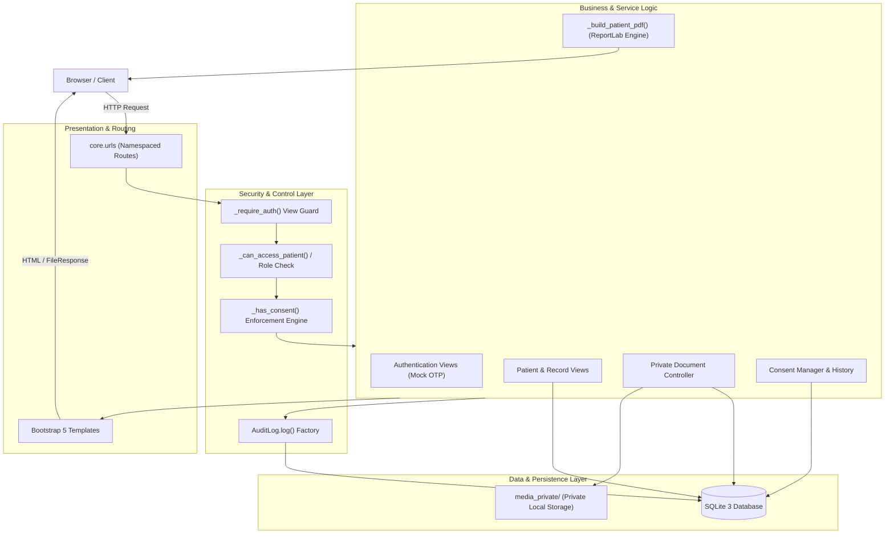
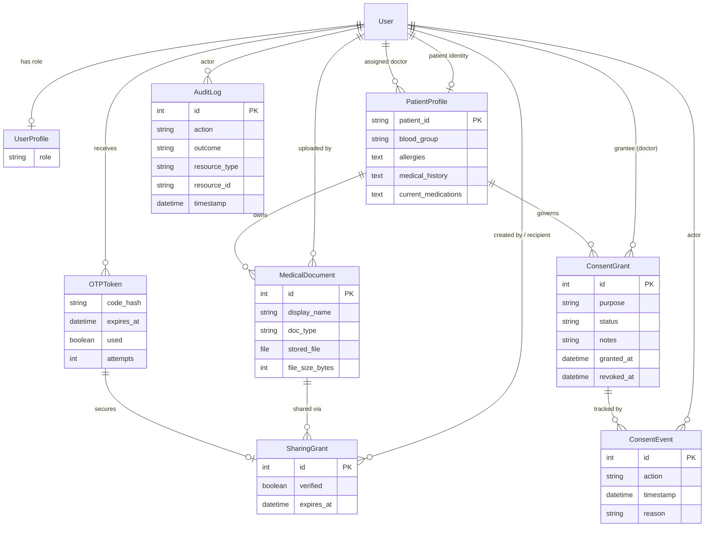

# Secure Health: Technical Documentation Manual

**Project Title:** Cybersecurity Framework for Secure Patient Data Transmission in Healthcare Networks  
**Repository:** `https://github.com/Anurag7645/patient_data_security`  
**Application Version:** 4.0.0 (Final Prototype with Patient Consent Management)  
**Date:** October 2026  
**Status:** Academic Research-Review Prototype  

---

## 1. Cover and Project Overview

### 1.1 Project Title and Status
*Secure Health* is an academic demonstration and research prototype developed to examine role-based access control (RBAC), multi-factor demonstration authentication (mock OTP), protected patient data transmission, recipient-bound medical document sharing, on-demand PDF report generation, and fine-grained patient consent management.

> [!WARNING]
> **Prototype Demonstration Notice:**  
> All patient records, user identities, clinical measurements, medical histories, allergies, and documents present in this system are **completely fictional**. This software is strictly an academic research prototype designed for demonstration, coursework assessment, and security architecture evaluation. It is **not** certified under HIPAA, GDPR, HITECH, or NHS Data Security and Protection Toolkit standards, and must not be used to store or transmit real-world Protected Health Information (PHI).

### 1.2 Purpose, Scope, and Intended Audience
The primary purpose of Secure Health is to provide a reference implementation of defense-in-depth principles in modern healthcare web applications:
- Enforcing strict separation of duties across administrative, clinical, managerial, and patient roles.
- Providing granular, purpose-bound patient consent that dynamically gates access to sensitive clinical records and documents.
- Protecting medical document transmission with cryptographic time-bound OTP verification and recipient restrictions.
- Logging security-critical events in a centralized application audit log.

The intended audience includes academic reviewers, software engineering peers, cybersecurity evaluators, and healthcare IT students.

---

## 2. Requirements and Feature Scope

### 2.1 Main Objectives
1. **Zero Public Disclosure:** Ensure medical records and documents cannot be accessed via static URLs, predictable links, or without active session authentication.
2. **Strict Role-Based Access Control (RBAC):** Restrict navigation and view actions according to predefined role permissions (Admin, Doctor, Management, Patient).
3. **Purpose-Specific Patient Consent:** Give patients sovereign control to grant and revoke access to their documents and reports on a per-doctor, per-purpose basis.
4. **Controlled Document Sharing:** Enable doctors to share clinical documents with specific registered recipients under short-lived OTP verification.
5. **On-Demand Summary Reports:** Generate dynamic, in-memory PDF clinical summaries without writing unencrypted documents to web-accessible disks.
6. **Application-Level Auditing:** Record all access requests, grants, revocations, download attempts, and denials with outcomes and timestamps.

### 2.2 Implemented Functionality Matrix
| Component | Sub-Feature | Implementation Detail | Status |
| :--- | :--- | :--- | :--- |
| **Authentication** | Email-driven mock OTP | Cryptographic 6-digit OTP generation, SHA-256 storage, 5-minute expiry, max 5 attempts, on-screen demo display panel | Completed |
| **RBAC** | Four defined roles | Admin, Doctor, Management, Patient via `UserProfile` and `PatientProfile` | Completed |
| **Clinical Records** | Fictional patient profiles | Demographics, blood group, allergies, medications, assigned doctor | Completed |
| **Document Vault** | Private document storage | Stored in `media_private/` outside web root, UUID-style safe filenames, magic-byte MIME validation (PDF, JPG, PNG, max 5 MB) | Completed |
| **Secure Downloads** | Auth-gated streaming | Served exclusively via `FileResponse` following role, assignment, and consent authorization checks | Completed |
| **OTP Document Sharing**| Time-limited sharing grants | 15-minute OTP-verified grants bound to specific recipient user accounts | Completed |
| **PDF Reporting** | In-memory summary PDFs | Dynamic PDF generation via ReportLab, watermarked disclaimer, safe content-disposition header | Completed |
| **Consent Management**| Patient-driven consent lifecycle | Purpose-specific grants (`access_documents`, `generate_report`, `view_record`), immediate revocation, append-only event trail | Completed |
| **Audit Logging** | Centralized security log | Structured events (`action`, `outcome`, `resource_type`, `resource_id`, `reason`) with admin filter view | Completed |

### 2.3 Explicitly Excluded Features
The following features are intentionally out of scope for this prototype:
- Live SMTP or SMS telecom gateways (all OTPs are displayed via UI for local offline demonstration).
- Third-party cloud identity providers (OAuth2, SAML, Okta, Auth0).
- Biometric authentication (FIDO2/WebAuthn).
- Distributed or microservices infrastructure (PostgreSQL, Redis, Celery, Docker, Kubernetes).
- Break-glass or emergency override mechanisms (to prevent arbitrary access bypasses in review).
- Hardware security modules (HSM) or hardware-enforced cryptographic immutability for SQLite audit tables.

---

## 3. Technology Stack and Dependencies

### 3.1 Core Technologies
- **Python:** 3.12+ (tested through 3.14 on Linux)
- **Framework:** Django 5.2 (LTS release track)
- **Database:** SQLite 3 (WAL journal mode enabled)
- **Frontend:** Django Templates, HTML5, CSS3, Bootstrap 5.3.3, Bootstrap Icons 1.11.3
- **PDF Generation:** ReportLab 4.4.x
- **Static Assets:** WhiteNoise 6.9.x for static asset serving in demonstration environments

### 3.2 Dependency Specification (`requirements.txt`)
```text
Django>=5.2,<5.3
reportlab>=4.4.0,<5.0.0
whitenoise>=6.9.0,<7.0.0
Pillow>=11.0.0
chardet>=5.2.0
```

### 3.3 Development Environment Assumptions
- **OS:** POSIX Linux (tested on Linux x86_64, Ubuntu 24.04 LTS / Debian-derivative).
- **Python Path:** Dedicated virtual environment (`venv/`). `manage.py` and `settings.py` incorporate automatic detection and sys.path injection to ensure consistent execution even when executed via system `python3`.
- **Local Storage:** Writable filesystem access for `db.sqlite3` and `media_private/`.

---

## 4. Architecture

### 4.1 Directory Structure
```text
patient_data_sec/
├── core/
│   ├── admin.py                      # Django admin configuration for all 8 models
│   ├── apps.py                       # CoreConfig application setup
│   ├── forms.py                      # DocumentUploadForm, ShareDocumentForm, ConsentGrantForm
│   ├── management/
│   │   └── commands/
│   │       └── seed_demo.py          # Deterministic demo seeder (users, profiles, docs, consents)
│   ├── migrations/
│   │   ├── 0001_initial.py           # Phase 2 initial schema (User, Role, OTP, Patient)
│   │   ├── 0002_auditlog_...py       # Phase 3 document storage, sharing, and audit log
│   │   └── 0003_consentgrant_...py   # Final Phase consent grant and consent event schema
│   ├── models.py                     # Domain models: Role, UserProfile, OTPToken, PatientProfile,
│   │                                 # MedicalDocument, SharingGrant, AuditLog, ConsentGrant, ConsentEvent
│   ├── templatetags/
│   │   └── core_tags.py              # Template helpers
│   ├── tests.py                      # Comprehensive test suite (97 tests covering all phases)
│   ├── urls.py                       # Route declarations with namespaced URL patterns
│   └── views.py                      # Flow handlers, RBAC logic, PDF rendering, consent enforcement
├── docs/
│   └── TECHNICAL_MANUAL.md           # This document
├── media_private/                    # Private storage directory (excluded from static serving)
├── secure_health/
│   ├── asgi.py                       # ASGI entrypoint
│   ├── settings.py                   # Central settings, security keys, media roots, WhiteNoise
│   ├── urls.py                       # Root URLconf delegating to core.urls
│   └── wsgi.py                       # WSGI entrypoint
├── static/                           # Custom CSS and branding assets
├── staticfiles/                      # Collected static assets
├── templates/
│   ├── base.html                     # Responsive navbar, role indicators, alerts
│   └── core/
│       ├── audit_log.html            # Admin audit log dashboard with outcome filtering
│       ├── consent_history.html      # Chronological audit timeline for a consent grant
│       ├── consent_manage.html       # Patient consent manager (active/revoked tables, grant form)
│       ├── dashboard.html            # Role-tailored home dashboard
│       ├── document_list.html        # Medical document listing
│       ├── document_upload.html      # Secure upload form with client/server validation
│       ├── home.html                 # Public welcome page
│       ├── login.html                # Step 1: Demo email entry & OTP display
│       ├── patient_detail.html       # Comprehensive patient record view
│       ├── patient_list.html         # Tabular patient directory
│       ├── share_document.html       # Doctor document sharing form
│       ├── share_verify.html         # Recipient OTP verification form
│       └── verify.html               # Step 2: Login OTP verification form
├── db.sqlite3                        # Local SQLite database
├── manage.py                         # Management script with automatic venv detection
├── README.md                         # Project overview and run instructions
└── requirements.txt                  # Pinned dependencies
```

### 4.2 System Architecture Diagram



---

## 5. Database and Data Model

### 5.1 Models and Entity Relationships

The schema consists of eight relational models defined in `core/models.py`:

1. **`UserProfile`**: Extends Django's `User` model with an enumerated role (`admin`, `doctor`, `management`, `patient`).
2. **`OTPToken`**: Ephemeral authentication token containing a SHA-256 hashed 6-digit code, expiry timestamp (5 minutes), attempt counter, and single-use flag.
3. **`PatientProfile`**: Fictional clinical identity linked to a `User` account, containing demographics, assigned doctor foreign key, blood group, allergies, medical history, and medications.
4. **`MedicalDocument`**: Metadata for uploaded medical documents referencing `PatientProfile` and uploader `User`, with a `FileField` targeting `media_private/`.
5. **`SharingGrant`**: Time-limited (15-minute) grant authorizing a specific recipient `User` to download a specific document after verifying a dedicated `OTPToken`.
6. **`AuditLog`**: Centralized log table recording `timestamp`, `user`, `action`, `resource_type`, `resource_id`, `outcome` (`SUCCESS`, `DENIED`, `FAILED`, `INFO`), and `reason`.
7. **`ConsentGrant`**: Patient-controlled grant establishing that a specific doctor (`grantee`) is authorized to perform an action (`purpose`) on a `PatientProfile`. Status is either `GRANTED` or `REVOKED`.
8. **`ConsentEvent`**: Append-only audit record detailing every change to a `ConsentGrant` (`action`: `granted`, `revoked`, `renewed`), recording the `actor`, `timestamp`, and `reason`.

### 5.2 Entity-Relationship (ER) Diagram



---

## 6. Authentication and Authorization

### 6.1 Demonstration Mock OTP Authentication Flow
1. **Email Entry (`/login/`):** The user submits their registered email.
2. **Cryptographic Generation:** The system uses Python's `secrets.choice("0123456789")` to generate a 6-digit numeric OTP.
3. **Secure Hash Storage:** The plaintext OTP is hashed using SHA-256 before persisting in `OTPToken`. The plaintext is never stored in the database.
4. **Demonstration Display Panel:** For offline evaluation without SMTP/SMS infrastructure, the plaintext OTP is displayed in a prominent, clearly labeled demonstration banner on `/verify/`.
5. **Code Verification (`/verify/`):**
   - The user inputs the 6-digit code.
   - The system checks if `used == False`, `expires_at > now()`, and `attempts < 5`.
   - The code hash is validated using `hmac.compare_digest` to prevent timing attacks.
   - On success, `token.used = True`, Django's `login(request, user)` establishes a secure session, and the user is redirected to `/dashboard/`.
   - On 5 failed attempts, the token is permanently invalidated.

### 6.2 Role Permissions Matrix
| Action / Route | Admin | Doctor (Assigned) | Doctor (Unassigned) | Management | Patient (Self) | Patient (Other) |
| :--- | :---: | :---: | :---: | :---: | :---: | :---: |
| **Login / Dashboard** | Allowed | Allowed | Allowed | Allowed | Allowed | Allowed |
| **Patient List (`/patients/`)** | All | Assigned only | None | All (Read-only) | Denied | Denied |
| **Patient Detail (`/patients/<id>/`)** | Allowed | Allowed | Denied (302) | Allowed (Demographics) | Allowed | Denied (302) |
| **Document List (`/patients/<id>/documents/`)** | Allowed | **Requires Consent** | Denied (302) | Denied (302) | Allowed | Denied (302) |
| **Document Upload (`.../upload/`)** | Allowed | Allowed | Denied (302) | Denied (302) | Denied (302) | Denied (302) |
| **Document Download (`/documents/<id>/download/`)** | Allowed | **Requires Consent** | Denied (302) | Denied (302) | Allowed | Denied (302) |
| **Document Share Creation (`.../share/`)** | Allowed | Allowed | Denied (302) | Denied (302) | Denied (302) | Denied (302) |
| **Recipient Share Verification / Download** | Recipient only | Recipient only | Recipient only | Recipient only | Recipient only | Recipient only |
| **PDF Report Generation (`.../report/`)** | Allowed | **Requires Consent** | Denied (302) | Denied (302) | Allowed | Denied (302) |
| **Consent Management (`.../consent/`)** | View only | Denied (302) | Denied (302) | Denied (302) | Manage (Grant/Revoke)| Denied (302) |
| **Audit Log (`/audit/`)** | Allowed | Denied (302) | Denied (302) | Denied (302) | Denied (302) | Denied (302) |

---

## 7. Patient Consent Workflow

### 7.1 Lifecycle and Purpose Scoping
Patients maintain full sovereign authority over their medical information. Access for assigned doctors is gated through active `ConsentGrant` records:

- **`access_documents`**: Authorizes the assigned doctor to view document lists and download uploaded clinical files.
- **`generate_report`**: Authorizes the assigned doctor to invoke ReportLab and generate the PDF medical summary report.
- **`view_record`**: Records consent for clinical chart inspection.

### 7.2 Grant and Revocation Rules
1. **Granting Consent:** A patient navigates to `/patients/<id>/consent/`, specifies the doctor's email, selects the purpose, adds optional notes, and submits. An active `ConsentGrant` is created along with an initial `ConsentEvent(action='granted')`.
2. **Idempotency:** Attempting to grant the same purpose to the same doctor while an active grant exists is recognized as a redundant operation, providing an informative alert without creating duplicates.
3. **Immediate Revocation:** The patient clicks "Revoke" on an active grant. The grant's status is immediately updated to `REVOKED`, `revoked_at` is set, and a `ConsentEvent(action='revoked')` is appended. The doctor's next attempt to access documents or generate reports is immediately rejected with an audit log denial.
4. **Append-Only History:** Consent records are **never deleted**. The `/consent/<grant_id>/history/` endpoint allows patients and administrators to audit every decision point, timestamp, and actor in chronological order.

---

## 8. Document Upload and Secure Sharing

### 8.1 Upload Restrictions and Validation
- **Size Limit:** Enforced at 5 MB (`5 * 1024 * 1024` bytes) in `DocumentUploadForm.clean_file()`.
- **Extension Whitelist:** Only `.pdf`, `.jpg`, `.jpeg`, and `.png` are accepted.
- **Header Inspection:** File contents are inspected for authentic magic bytes:
  - PDF: `%PDF` header (`0x25 0x50 0x44 0x46`).
  - JPEG: SOI marker (`0xFF 0xD8`).
  - PNG: Magic header (`0x89 0x50 0x4E 0x47 0x0D 0x0A 0x1A 0x0A`).
- **Filename Sanitization:** Uploaded files are stored with randomly generated or sanitized names inside `media_private/` to prevent directory traversal or remote code execution.

### 8.2 Recipient-Bound Document Sharing
Doctors can share documents with other registered users (such as consulting specialists) without granting permanent record access:
1. The doctor selects a document and submits the recipient's email.
2. A `SharingGrant` is created with a 15-minute expiration timestamp and an associated `OTPToken`.
3. The recipient logs in and visits `/share/<grant_id>/verify/`.
4. Entering the correct OTP verifies the grant (`verified = True`).
5. The recipient downloads the file at `/share/<grant_id>/download/`. Once expired (`now > expires_at`), download access is permanently denied.

---

## 9. PDF Patient Reports

### 9.1 Report Generation Architecture
The patient summary report is implemented in `core/views.py` using `ReportLab`:
- **Route:** `GET /patients/<patient_id>/report/`
- **Output:** Streaming `application/pdf` attachment named `report_<patient_id>.pdf`.
- **In-Memory Rendering:** Built entirely within a `io.BytesIO` buffer; no temporary unencrypted PDF files are written to disk.
- **Styling and Security Features:**
  - Secure Health branding banner with date and timestamp.
  - Prominent red academic disclaimer banner: *"Academic Research Prototype – All Data Fictional"*.
  - Patient demographics table (DOB, Gender, Blood Group, Doctor).
  - Clinical details (Allergies, Medical History, Medications).
  - Document summary section showing all uploaded files and types.

---

## 10. Installation and Setup

### 10.1 Quick Start Commands
Run the following commands from the repository root:

```bash
# 1. Clone repository
git clone https://github.com/Anurag7645/patient_data_security.git
cd patient_data_security

# 2. Setup virtual environment
python3 -m venv venv
source venv/bin/activate

# 3. Install pinned dependencies
pip install -r requirements.txt

# 4. Run database migrations
python3 manage.py migrate

# 5. Seed fictional demo data and demo consents
python3 manage.py seed_demo

# 6. Run automated test suite
python3 manage.py test core --verbosity=1

# 7. Collect static files
python3 manage.py collectstatic --noinput

# 8. Start local server
python3 manage.py runserver 127.0.0.1:8000
```

---

## 11. Demo Accounts and Demonstration Guide

### 11.1 Available Demonstration Accounts
All accounts use passwordless email OTP authentication. Enter the email address at `/login/`, then submit the 6-digit code displayed in the demonstration panel.

| Email Address | Role | Name | Clinical Assignments / Purpose |
| :--- | :--- | :--- | :--- |
| `admin@securehealth.demo` | **Admin** | Alex Morgan | Full system access, document vault management, system audit log inspector |
| `doctor1@securehealth.demo` | **Doctor** | Dr. Sam Carter | Assigned to Chris Blake (SH-P-0001) and Taylor Ford (SH-P-0002). Pre-seeded with consent for Blake. |
| `doctor2@securehealth.demo` | **Doctor** | Dr. Ria Patel | Assigned to Morgan Hayes (SH-P-0003) and Jamie Ward (SH-P-0004). |
| `management@securehealth.demo`| **Management** | Jordan Chen | High-level directory review. Strict zero-access to medical documents and clinical reports. |
| `patient1@securehealth.demo` | **Patient** | Chris Blake (SH-P-0001) | Full sovereignty: view own records, manage consent, review consent history. |
| `patient2@securehealth.demo` | **Patient** | Taylor Ford (SH-P-0002) | Fictional patient with no active doctor consent pre-granted. |
| `patient3@securehealth.demo` | **Patient** | Morgan Hayes (SH-P-0003)| Fictional patient assigned to Dr. Patel. |
| `patient4@securehealth.demo` | **Patient** | Jamie Ward (SH-P-0004) | Fictional patient assigned to Dr. Patel. |

### 11.2 Recommended 7-Minute Demonstration Sequence
1. **Login as Admin:** Inspect the system dashboard and the centralized audit log (`/audit/`). Note historical events and filtering options.
2. **Login as Management:** Browse the patient directory (`/patients/`). Attempt to click "View Documents" or generate a PDF report—observe immediate RBAC denial.
3. **Login as Doctor 1:** View assigned patient Chris Blake (`SH-P-0001`). Because consent was pre-seeded, access the document list and generate the PDF summary report. Next, view Taylor Ford (`SH-P-0002`) and attempt to access documents—observe the consent enforcement block.
4. **Login as Patient 2 (Taylor Ford):** Navigate to "Manage My Consent" (`/patients/SH-P-0002/consent/`). Grant `Access Patient Documents` to `doctor1@securehealth.demo`.
5. **Re-test Doctor 1:** Refresh Taylor Ford's document page—access is now permitted.
6. **Revoke Consent as Patient 2:** Return to the consent manager and click "Revoke". View the consent history timeline showing the append-only `Granted` and `Revoked` events.
7. **Verify Immediate Block:** As Doctor 1, attempt to download Taylor Ford's document again—access is blocked immediately and logged in the audit trail.

---

## 12. Testing and Verification

### 12.1 Automated Test Suite
The automated test suite in `core/tests.py` covers 97 test cases across all components:

```bash
python3 manage.py test core --verbosity=2
```

### 12.2 Test Results Summary
```text
Found 97 test(s).
Creating test database for alias 'default'...
System check identified no issues (0 silenced).
.................................................................................................
----------------------------------------------------------------------
Ran 97 tests in 1.352s

OK
Destroying test database for alias 'default'...
```

### 12.3 Test Coverage Breakdown
- **OTP Model & Lifecycle (8 tests):** Token generation, SHA-256 hash matching, expiration calculations, single-use invalidation, attempt lockout.
- **Login & Verification Views (7 tests):** Invalid emails, unauthenticated redirects, valid code sessions, brute-force lockout.
- **Dashboard RBAC (5 tests):** Role-specific interface rendering for all four user roles.
- **Patient Directory & Record Access (10 tests):** Doctor assignment boundaries, management read-only boundaries, patient isolation.
- **Document Upload & Security (7 tests):** Extension filtering, magic-byte forgery rejection, 5 MB file size enforcement, unassigned doctor rejections.
- **Document Access & Download (7 tests):** Authenticated streaming, assigned doctor permissions, management denials, patient isolation.
- **OTP Document Sharing (10 tests):** Grant creation, 15-minute expiration, recipient binding, OTP challenge enforcement.
- **Application Audit Log (3 tests):** Log creation, admin-only viewing, outcome filtering (`SUCCESS`, `DENIED`).
- **Integration & Route Integrity (3 tests):** Clean startup, form validation, reverse URL resolution across all views.
- **PDF Summary Reports (10 tests):** In-memory rendering, content verification, disclaimer presence, unassigned doctor denial, audit logging.
- **Consent Management & Models (27 tests):** Model properties, string representations, multi-purpose independence, patient self-management, patient cross-boundary rejection, doctor non-consent denials, consent grant/revoke workflows, append-only history audits, and idempotency.

---

## 13. Security Considerations and Limitations

1. **Academic Demonstration Scope:** Designed specifically for functional demonstrations and security model validation. Not evaluated for clinical deployment.
2. **Local Mock OTP:** Plaintext OTP codes are displayed directly on-screen in the browser for testing convenience. In a production environment, this must be replaced with an authenticated out-of-band delivery channel (e.g., enterprise SMS or transactional SMTP) and the debug display removed.
3. **Storage Security:** In this prototype, files are stored on the local filesystem in `media_private/`. Production healthcare systems require AES-256 server-side encryption at rest (such as AWS S3 SSE-KMS or encrypted block storage) with strict IAM roles.
4. **Audit Log Hardening:** The `AuditLog` table resides in SQLite. While protected against modification via Django Admin (`has_change_permission = False`, `has_delete_permission = False`), production compliance mandates write-once-read-many (WORM) storage, remote syslog forwarding, or cryptographic tamper-evident signing.
5. **No Break-Glass Access:** For strict adherence to the project specification, no emergency override mechanism is implemented.

---

## 14. Troubleshooting

| Symptom | Probable Cause | Corrective Action |
| :--- | :--- | :--- |
| `ImportError: No module named 'reportlab'` | Virtual environment not activated | Activate virtual environment (`source venv/bin/activate`) or run via `python3 manage.py` which auto-includes `venv`. |
| `no such table: core_consentgrant` | Unapplied migrations | Run `python3 manage.py migrate`. |
| "You do not have the patient's consent..." | Assigned doctor lacks active consent | Have the patient log in and grant the required purpose via their consent manager. |
| "File does not appear to be a valid PDF" | Spoofed extension or corrupt header | Ensure the uploaded file starts with genuine `%PDF` magic bytes. |
| 403 / CSRF Verification Failed | Missing CSRF cookie or stale session | Clear browser session cookies and submit form through Django-rendered page. |

---

## 15. Maintenance and Future Work

### 15.1 Maintenance Procedures
- **Adding New Models:** Place model classes in `core/models.py`, generate migrations with `python3 manage.py makemigrations core`, apply with `python3 manage.py migrate`, and register in `core/admin.py`.
- **Extending Consent Purposes:** Add new choices to `ConsentPurpose` in `core/models.py` and implement checking guards via `_has_consent(profile, user, ConsentPurpose.<NEW_PURPOSE>)`.

### 15.2 Future Extensions
- Integrating FIDO2 WebAuthn hardware security keys.
- Implementing asymmetric end-to-end encryption (E2EE) using OpenPGP or WebCrypto for uploaded files.
- FHIR (Fast Healthcare Interoperability Resources) REST API endpoints with OAuth2 Scopes matching consent grants.

---

## 16. Glossary and References

- **RBAC (Role-Based Access Control):** Restricting system access to authorized users based on their assigned organizational role.
- **OTP (One-Time Password):** A dynamic passcode valid for only a single login session or transaction.
- **Consent Grant:** A formal permission record created by a patient allowing a specific clinician to access clinical data for a defined purpose.
- **Principle of Least Privilege:** Granting users only the minimal access necessary to perform their legitimate job responsibilities.
- **WhiteNoise:** High-performance static file serving middleware for Python web applications.
- **ReportLab:** Open-source Python library for generating dynamic PDF documents.
